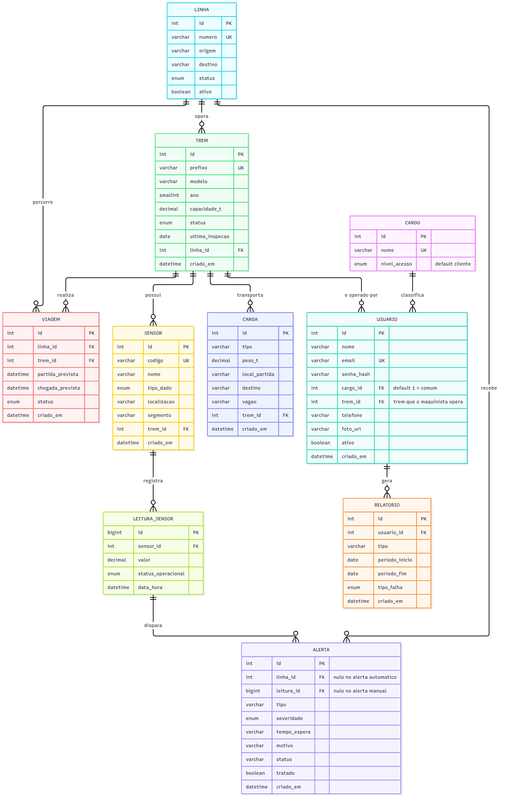
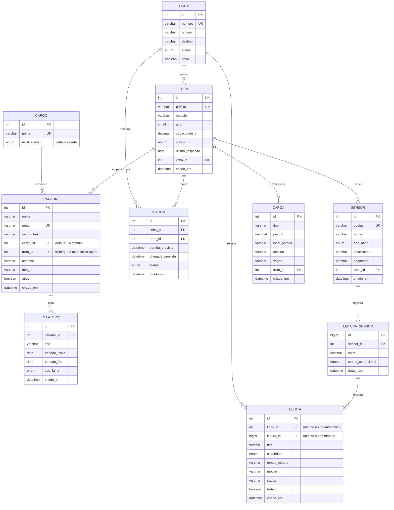

# Modelo de dados — Ferrovia Santa Cruz

> Modelo relacional do banco (MySQL 8, SQL puro). Reúne **o que o mockup da SA exige** (usuários, linhas, carga, alertas) com **o que a Avaliação Prática de Banco de Dados pede** (trens, sensores IoT, leituras em tempo real, relatórios). Um schema só, sem duplicação.
>
> Referenciado pelo [`PLANO_IMPLEMENTACAO.md`](../PLANO_IMPLEMENTACAO.md) (Seção 2). Fonte da verdade para o [`db/script.sql`](../../db/script.sql), o arquivo único que cria o banco do zero.
>
> **Atualizado em 2026-11-03** para cobrir o que faltava dos blocos 2 e 4 do Guia: campos de trem e de sensor exigidos pelas telas, severidade de alerta, vínculo do maquinista com o trem e a tabela `viagem`. As decisões e o *porquê* de cada uma estão em [`../decisoes/fechamento-sa.md`](../decisoes/fechamento-sa.md).

## Diagrama Entidade-Relacionamento

DER do schema vigente — é o artefato que a SA pede como entrega. Gerado a partir do bloco Mermaid abaixo (`diagrama-er.mmd`), que é a fonte versionável: editou o modelo, reexporte com

```bash
docker run --rm -u "$(id -u):$(id -g)" -e HOME=/tmp -v "$PWD/docs/banco:/data" \
  minlag/mermaid-cli -i diagrama-er.mmd -o diagrama-er.png -b white -s 3
```



O mesmo modelo em Mermaid (versionável, edita-no-texto):



## Entidades e relacionamentos

| Entidade | O que é | Relacionamentos | Vem de |
|----------|---------|-----------------|--------|
| **cargo** | Função do usuário (comum, admin, maquinista…). `nivel_acesso` encoda a matriz de acesso. | classifica N `usuario` | Mockup (cargo do funcionário) + normalização do antigo ENUM |
| **usuario** | Quem acessa o sistema (login). Aponta pra um `cargo` (default `comum`) e, se for maquinista, pro `trem` que opera. | gera N `relatorio`; tem 1 `cargo`; opera 1 `trem` (opcional) | Mockup (login, funcionários, perfil) + atividade DB (login/admin) + Guia bloco 4 (painel do maquinista) |
| **linha** | Rota da ferrovia: número, trajeto (`origem` → `destino`) e status operacional. | opera N `trem`; recebe N `alerta`; percorrida por N `viagem` | Mockup (Gestão de Rotas) + Guia §1.3 (trajeto) |
| **trem** | Composição, identificada pelo `prefixo` (padrão `TR-204`), com modelo, ano, capacidade e última inspeção. | tem N `sensor`; transporta N `carga`; realiza N `viagem` | Atividade DB (monitoramento) + Guia bloco 2 (tela de trens) |
| **sensor** | Sensor IoT de um trem, identificado pelo `codigo` (padrão `S-TEMP-001`). | tem N `leitura_sensor` | Atividade DB (cadastro de sensores) + Guia bloco 2 (tela de sensores) |
| **viagem** | A viagem de um trem numa linha, com horários previstos e status. É daqui que saem "viagens em andamento" e o relatório de eficiência operacional. | pertence a 1 `linha` e a 1 `trem` | Guia §1.3 e bloco 4 (ver [`E1`](../decisoes/fechamento-sa.md)) |
| **leitura_sensor** | Cada medição enviada por um sensor (velocidade, temperatura, falha…) com status operacional. | pertence a 1 `sensor` | Atividade DB (monitoramento em tempo real) |
| **carga** | Carga/passageiros transportados, com peso, partida e destino. | vai em 1 `trem` (opcional) | Mockup (Monitoramento de Carga) |
| **alerta** | Alerta **manual** sobre uma linha ou **automático** a partir de uma leitura fora do limite. Tem tipo, severidade e marca de tratado. | pertence a 1 `linha` **ou** a 1 `leitura_sensor` | Mockup (Alertas) + Guia §1.3 (severidade) + bloco 3 (alerta automático) |
| **relatorio** | Relatório operacional gerado por um usuário, filtrável por período e tipo de falha. | pertence a 1 `usuario` | Atividade DB (cadastro/visualização de relatórios) |

## Detalhe das tabelas

### `cargo`
| Coluna | Tipo | Restrições |
|--------|------|------------|
| `id` | INT | PK, AUTO_INCREMENT |
| `nome` | VARCHAR(40) | NOT NULL, **UNIQUE** |
| `nivel_acesso` | ENUM(`cliente`,`operacional`,`gestao`) | NOT NULL, **DEFAULT `cliente`** |

Os 10 cargos seedados e seu nível de acesso (a **matriz de acesso vive no banco**, não em código):

| nivel_acesso | cargos | Pode |
|--------------|--------|------|
| `cliente` | `comum` | só o próprio perfil |
| `operacional` | `maquinista`, `auxiliar_maquinista`, `agente_trem`, `manutencao`, `engenharia_mecanica`, `eletricista` | painel operacional (monitoramento), sem gerir usuários |
| `gestao` | `admin`, `administracao`, `rh` | gestão completa, inclui gerir usuários |

### `usuario`
| Coluna | Tipo | Restrições |
|--------|------|------------|
| `id` | INT | PK, AUTO_INCREMENT |
| `nome` | VARCHAR(120) | NOT NULL |
| `email` | VARCHAR(160) | NOT NULL, **UNIQUE** |
| `senha_hash` | VARCHAR(255) | NOT NULL (senha sempre com hash, nunca texto puro) |
| `cargo_id` | INT | NOT NULL, **DEFAULT 1** (= `comum`, seedado como id 1), **FK → cargo(id) ON DELETE RESTRICT** |
| `trem_id` | INT | NULL, **FK → trem(id) ON DELETE SET NULL** (o trem que o maquinista opera) |
| `telefone` | VARCHAR(20) | NULL |
| `foto_url` | VARCHAR(255) | NULL |
| `ativo` | BOOLEAN | NOT NULL, DEFAULT TRUE |
| `criado_em` | DATETIME | NOT NULL, DEFAULT CURRENT_TIMESTAMP |

Todo registro novo nasce `comum` (DEFAULT 1); só um admin promove. O acesso de cada tela é derivado do `nivel_acesso` do cargo do usuário (um JOIN `usuario → cargo`).

> **Decisão superada (não apagada):** o cargo era um **ENUM único em `usuario`** ("decisão do grupo" original). Foi normalizado pra a tabela `cargo` porque (1) o ENUM de 10 valores era grande e mexer nele exigia `ALTER TABLE` (DDL), (2) uma tabela com FK demonstra mais modelagem relacional — relevante numa avaliação de Banco — e (3) a matriz de acesso vira **dado** (`nivel_acesso`) em vez de regra espalhada em código. O comportamento "nasce comum" foi preservado via `DEFAULT 1`.

### `linha`
| Coluna | Tipo | Restrições |
|--------|------|------------|
| `id` | INT | PK, AUTO_INCREMENT |
| `numero` | VARCHAR(20) | NOT NULL, UNIQUE (ex: "1778") |
| `origem` | VARCHAR(120) | NOT NULL (ex: "Joinville") |
| `destino` | VARCHAR(120) | NOT NULL (ex: "Sao Francisco do Sul") |
| `status` | ENUM(`manutencao`,`atraso`,`fechado`,`na_estacao`,`ja_partiu`) | NOT NULL |
| `ativo` | BOOLEAN | NOT NULL, DEFAULT TRUE |

O *trajeto* que o Guia §1.3 exige na tela de rotas é `origem → destino`, montado na exibição. Não há coluna `trajeto`: ela seria a concatenação de duas que já existem.

### `trem`
| Coluna | Tipo | Restrições |
|--------|------|------------|
| `id` | INT | PK, AUTO_INCREMENT |
| `prefixo` | VARCHAR(20) | NOT NULL, **UNIQUE** (padrão `TR-204` do Guia §4.5) |
| `modelo` | VARCHAR(80) | NOT NULL |
| `ano` | SMALLINT | NOT NULL (a API valida 1900..2100) |
| `capacidade_t` | DECIMAL(7,2) | NOT NULL, em toneladas (a API valida > 0) |
| `status` | ENUM(`ativo`,`manutencao`,`parado`) | NOT NULL, DEFAULT `ativo` |
| `ultima_inspecao` | DATE | NULL (vazia enquanto o trem não foi inspecionado) |
| `linha_id` | INT | NULL, **FK → linha(id) ON DELETE SET NULL** |
| `criado_em` | DATETIME | NOT NULL, DEFAULT CURRENT_TIMESTAMP |

A coluna era `identificador VARCHAR(40)` e virou `prefixo VARCHAR(20)`: o Guia fixa o nome e o padrão visível (`TR-204`), e a tela de trens filtra e busca por ele. A unicidade é **do banco** e não da aplicação — ver [`E6`](../decisoes/fechamento-sa.md).

### `sensor`
| Coluna | Tipo | Restrições |
|--------|------|------------|
| `id` | INT | PK, AUTO_INCREMENT |
| `codigo` | VARCHAR(20) | NOT NULL, **UNIQUE** (padrão `S-TEMP-001` do Guia §4.5) |
| `nome` | VARCHAR(80) | NOT NULL |
| `tipo_dado` | ENUM(`velocidade`,`temperatura`,`falha`,`energia`,`localizacao`) | NOT NULL (é por ele que a tela filtra) |
| `localizacao` | VARCHAR(120) | NOT NULL (onde está no trem: motor, eixo dianteiro, cabine) |
| `segmento` | VARCHAR(80) | NULL (trecho da malha em que opera) |
| `trem_id` | INT | NOT NULL, **FK → trem(id) ON DELETE RESTRICT** (todo sensor pertence a um trem) |
| `criado_em` | DATETIME | NOT NULL, DEFAULT CURRENT_TIMESTAMP |

**Não existe coluna `ultima_leitura`.** O indicador normal/atenção/crítico que a tela mostra é derivado da leitura mais recente daquele sensor, e o índice `(sensor_id, data_hora)` de `leitura_sensor` cobre essa consulta. O Guia do bloco 2 previa a coluna preenchida à mão e o próprio bloco 3 manda passar a calculá-la — ver [`E7`](../decisoes/fechamento-sa.md).

### `viagem`
| Coluna | Tipo | Restrições |
|--------|------|------------|
| `id` | INT | PK, AUTO_INCREMENT |
| `linha_id` | INT | NOT NULL, **FK → linha(id) ON DELETE RESTRICT** |
| `trem_id` | INT | NOT NULL, **FK → trem(id) ON DELETE RESTRICT** |
| `partida_prevista` | DATETIME | NOT NULL |
| `chegada_prevista` | DATETIME | NOT NULL |
| `status` | ENUM(`programada`,`em_andamento`,`concluida`,`cancelada`,`atrasada`) | NOT NULL, DEFAULT `programada` |
| `criado_em` | DATETIME | NOT NULL, DEFAULT CURRENT_TIMESTAMP |

Tabela nova (2026-11-03). `linha` tem **um** status atual; viagem tem histórico. Sem ela, "viagens em andamento" no painel e "viagens concluídas, canceladas e atrasadas por trem" no relatório de eficiência não existem — ver [`E1`](../decisoes/fechamento-sa.md).

### `leitura_sensor`
| Coluna | Tipo | Restrições |
|--------|------|------------|
| `id` | BIGINT | PK, AUTO_INCREMENT (volume alto de medições) |
| `sensor_id` | INT | NOT NULL, **FK → sensor(id) ON DELETE RESTRICT** |
| `valor` | DECIMAL(10,2) | NOT NULL |
| `status_operacional` | ENUM(`normal`,`alerta`,`falha`) | NOT NULL, DEFAULT `normal` |
| `data_hora` | DATETIME | NOT NULL, DEFAULT CURRENT_TIMESTAMP |

**Regra de negócio crítica (atividade DB, item 6):** o FK usa **`ON DELETE RESTRICT`**. É isso que impede excluir um sensor que tenha leituras registradas — o banco rejeita o DELETE e a API devolve a mensagem *"Não é possível excluir sensores com dados registrados"*. A regra mora no schema, não só no código.

### `carga`
| Coluna | Tipo | Restrições |
|--------|------|------------|
| `id` | INT | PK, AUTO_INCREMENT |
| `tipo` | VARCHAR(80) | NOT NULL |
| `peso_t` | DECIMAL(6,2) | NOT NULL (toneladas) |
| `local_partida` | VARCHAR(120) | NOT NULL |
| `destino` | VARCHAR(120) | NOT NULL |
| `vagao` | VARCHAR(20) | NULL |
| `trem_id` | INT | NULL, **FK → trem(id)** |
| `criado_em` | DATETIME | NOT NULL, DEFAULT CURRENT_TIMESTAMP |

### `alerta`
| Coluna | Tipo | Restrições |
|--------|------|------------|
| `id` | INT | PK, AUTO_INCREMENT |
| `linha_id` | INT | **NULL**, **FK → linha(id) ON DELETE CASCADE** (preenchido no alerta manual) |
| `leitura_id` | BIGINT | NULL, **FK → leitura_sensor(id) ON DELETE SET NULL** (preenchido no alerta automático) |
| `tipo` | VARCHAR(40) | NOT NULL (ex: `manutencao`, `atraso`, `temperatura`, `falha`) |
| `severidade` | ENUM(`normal`,`atencao`,`critico`) | NOT NULL, DEFAULT `normal` |
| `tempo_espera` | VARCHAR(40) | NULL (ex: "15 a 30 min") |
| `motivo` | VARCHAR(200) | NOT NULL |
| `status` | VARCHAR(40) | NOT NULL (ex: "Parado") |
| `tratado` | BOOLEAN | NOT NULL, DEFAULT FALSE |
| `criado_em` | DATETIME | NOT NULL, DEFAULT CURRENT_TIMESTAMP |

Um alerta tem `linha_id` **ou** `leitura_id`, nunca os dois: o manual fala de uma linha, o automático nasce de uma leitura fora do limite. É por `leitura_id → sensor → trem` que o relatório de manutenção agrupa alertas por trem. `severidade` usa as cores semânticas fixas do Guia §4.1 (normal=verde, atenção=amarelo, crítico=vermelho), e **"alerta ativo" é `tratado = FALSE`** — ver [`E4`](../decisoes/fechamento-sa.md) e [`E5`](../decisoes/fechamento-sa.md).

### `relatorio`
| Coluna | Tipo | Restrições |
|--------|------|------------|
| `id` | INT | PK, AUTO_INCREMENT |
| `usuario_id` | INT | NOT NULL, **FK → usuario(id)** |
| `tipo` | VARCHAR(80) | NOT NULL |
| `periodo_inicio` | DATE | NOT NULL |
| `periodo_fim` | DATE | NOT NULL |
| `tipo_falha` | ENUM(`normal`,`alerta`,`falha`) | NULL (filtro por tipo de falha) |
| `criado_em` | DATETIME | NOT NULL, DEFAULT CURRENT_TIMESTAMP |

## Integridade referencial (resumo)

| FK | Aponta para | ON DELETE | Por quê |
|----|-------------|-----------|---------|
| `usuario.cargo_id` | `cargo` | RESTRICT | não apagar um cargo que ainda tem usuários |
| `usuario.trem_id` | `trem` | SET NULL | o maquinista continua existindo se o trem sair de operação |
| `trem.linha_id` | `linha` | SET NULL | trem pode existir sem linha atribuída |
| `sensor.trem_id` | `trem` | RESTRICT | não soltar sensor órfão; excluir trem com sensor vira 409 |
| `leitura_sensor.sensor_id` | `sensor` | **RESTRICT** | **regra do item 6 — sensor com dados não some** |
| `viagem.linha_id` | `linha` | RESTRICT | viagem é registro histórico; sem a linha o relatório de eficiência perde a referência |
| `viagem.trem_id` | `trem` | RESTRICT | idem, pelo lado do trem |
| `carga.trem_id` | `trem` | SET NULL | carga histórica sobrevive ao trem |
| `alerta.linha_id` | `linha` | CASCADE | alerta manual não faz sentido sem a linha |
| `alerta.leitura_id` | `leitura_sensor` | SET NULL | o alerta vale como histórico mesmo sem a leitura de origem |
| `relatorio.usuario_id` | `usuario` | RESTRICT | preservar autoria do relatório |

Apagar um pai referenciado dispara o erro **1451** do MySQL (`ER_ROW_IS_REFERENCED_2`), traduzido pelo handler global de `app/main.py` em **409 "Registro em uso por outro cadastro"**. A mensagem específica de cada tela (por exemplo *"não é possível excluir um sensor que já tem leituras registradas"*) é dada pelo frontend, que sabe qual ação o usuário disparou.

## População (seed)

A atividade DB exige **≥3 registros por tabela**, respeitando tipos, PKs e FKs. Ordem de inserção (respeita as dependências): `cargo` → `linha` → `trem` → `usuario` → `sensor` → `leitura_sensor` → `alerta` → `viagem` → `carga` → `relatorio`. Inserir os pais antes dos filhos, senão o FK falha. `usuario` passou a vir depois de `trem` porque agora aponta pra ele.

Schema e carga moram no **mesmo arquivo**, [`db/script.sql`](../../db/script.sql), que apaga e recria tudo a cada importação (ver [`E9`](../decisoes/fechamento-sa.md)). Três detalhes do seed que não são óbvios:

- `cargo` é seedado com **id explícito** (1 = `comum`) pra casar com o `DEFAULT 1` de `usuario`.
- As FKs são resolvidas por **subconsulta no campo único** (`(SELECT id FROM trem WHERE prefixo = 'TR-204')`), não por id mágico — reordenar um `INSERT` não quebra nada.
- As datas são **relativas a `CURRENT_TIMESTAMP`** (`- INTERVAL 6 HOUR`), não fixas. É isso que mantém dado dentro da janela de 24h da velocidade média e viagens em andamento em qualquer dia em que o projeto for importado. Com datas fixas, o painel do avaliador mostraria "sem dados".

A carga foi dimensionada pra que painel e relatórios mostrem resultado **na primeira importação**: trens nos três status, sensores dos cinco tipos, dez leituras em janelas de tempo diferentes, alertas em mais de uma severidade (tratados e não tratados) e viagens nos cinco status.

## Lacuna conhecida — "localização em mapa" (tela 7)

A Tela de Monitoramento em Tempo Real (item 7 da SA) pede mostrar o trem **num mapa**, o que exige **latitude/longitude**. O modelo atual guarda `sensor.localizacao` como texto e `leitura_sensor.valor` como um único `DECIMAL` — não há onde armazenar um par de coordenadas. **Não está implementado** (fora do escopo da entrega de Banco, que não exige o mapa funcionando). Quando a tela for pra valer, opções: adicionar `latitude`/`longitude` em `leitura_sensor`, ou uma tabela `posicao(trem_id, lat, long, data_hora)`.
