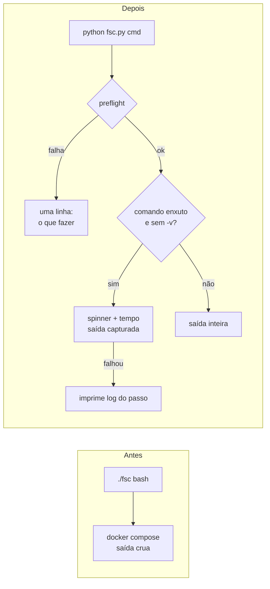
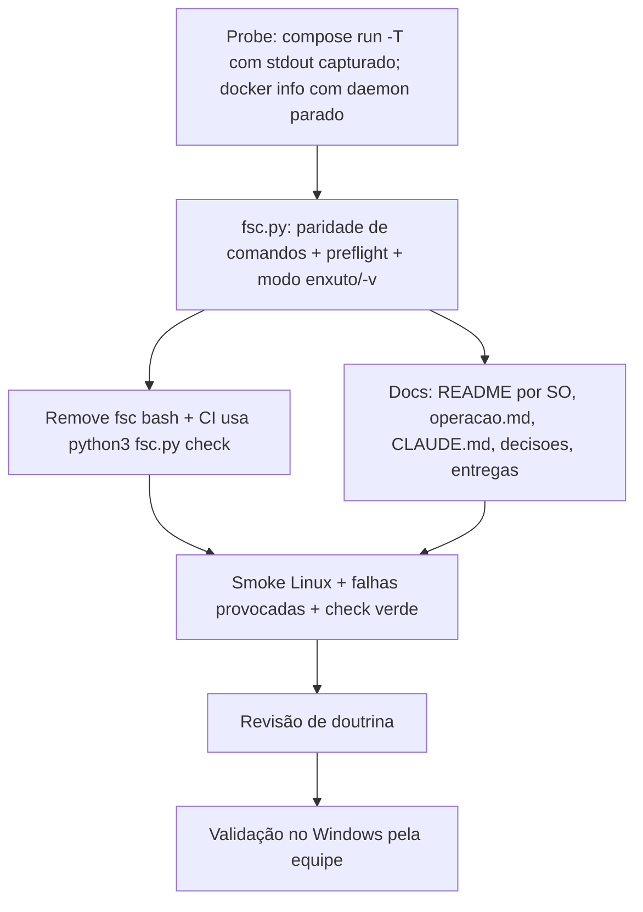

# fsc Multiplataforma (Living Plan)

> Status: **LOCKED** — decisions resolved · Locked: 2026-11-06
> Owner: lowh · Created: 2026-11-06
> This file is the **plan of record** and is meant to be iterated on. The sections below are the FLOOR, not the ceiling.

---

## 1. Goal (one paragraph)

Reescrever o `./fsc` (hoje bash) em Python, para que o mesmo script rode em Linux, macOS e Windows. Ele deve ser amigável: mostrar só o necessário e, quando algo do ambiente impede a subida (Docker ausente, daemon parado, Compose ausente, porta ocupada), dizer em uma linha o que está errado e como resolver. O README ganha instruções separadas por sistema operacional.

---

## 2. Locked Decisions

| #  | Decision | Detail |
|----|----------|--------|
| L1 | Linguagem do `fsc` | Python, decidido pelo usuário em 2026-11-06 (sobre a alternativa bash + `fsc.cmd`). |
| L2 | Invocação | Um arquivo só, `fsc.py`, sem shim `.cmd`. Todo SO chama `python fsc.py <comando>`. O bash `fsc` sai. |
| L3 | Saída enxuta | Vale para quase todos os comandos; um parâmetro faz sair tudo (a saída crua do docker). |
| L4 | Idioma | Mensagens e help em português. |
| L5 | Preflight | Docker instalado · daemon rodando · plugin Compose · porta 5173 livre (só no `up`). Cada falha = uma linha dizendo o que fazer. |
| L6 | Saída inteira sempre | `logs`, `sh`, `db`, `ps`, `test`, `npm`, `ui add` (movido na revisão: o shadcn pode perguntar), `sim`; nesses o `-v` vai pro programa de dentro. Enxutos: `up`, `down`, `restart`, `build`, `check`, `lint`, `fmt`, `typecheck`, `db:reset`. Passo enxuto que falha imprime o log daquele passo e para. |
| L7 | Parâmetro | `-v` / `--verboso`, aceito em qualquer posição. |
| L8 | Invocação Linux/mac/CI | `python3 fsc.py <cmd>`; arquivo com shebang e bit executável (`./fsc.py` também vale). CI: `python3 fsc.py check`. Windows: `python fsc.py <cmd>`. |
| L9 | Progresso | Spinner + tempo decorrido na mesma linha em passo enxuto; vira `ok (1m40s)`. Fora de TTY (CI) só a linha final. |
| L10 | Prova | Sem teste automatizado do `fsc.py` (L27 restringe teste ao backend; é ferramenta). Smoke manual no Linux de cada comando + falhas provocadas (docker parado, porta ocupada) + CI `check`. Windows validado pelo usuário/equipe antes do merge. |
| L11 | Python | 3.10+, só biblioteca padrão. Abaixo disso o script avisa e sai. Python no host vira exigência registrada (exceção ao "nunca python do host"). |
| L12 | Docs | Troca `./fsc` → `fsc.py` em todo doc vivo (README com seção por SO, `operacao.md`, `.claude/CLAUDE.md`, CLAUDE.md de pastas, `docs/decisoes`, `docs/entregas`). `docs/tasks/` históricos ficam intactos. |

---

## 3. Open Decisions

- [x] _nenhuma — todas travadas_

---

## 4. Codebase Findings

- `fsc` atual: bash, 208 linhas, `set -euo pipefail`, `cd` para a raiz via `readlink -f`. Comandos: `up down restart logs ps build sh test lint fmt typecheck check db db:reset npm ui sim help`.
- Exporta `HOST_UID`/`HOST_GID` com `id -u`/`id -g`; `docker-compose.yml:23,42` usa `user: "${HOST_UID:-1000}:${HOST_GID:-1000}"`. No Windows `os.getuid` não existe; o default `1000` do compose cobre.
- `ensure_env_file` copia `.env.example` → `.env` em toda chamada se faltar.
- `check` roda 9 passos em sequência e para no primeiro que falha (`run_step`).
- `db:reset` pede para digitar `reset` (`--yes` pula), remove o container `db` e o volume `<projeto>_db_data` (nome lido de `docker compose config`).
- CI (`.github/workflows/ci.yml`) roda `./fsc check` em `ubuntu-latest`, que já tem `python3`.
- Mensagens do `fsc` hoje em inglês; o projeto exige identificadores em português (`.claude/CLAUDE.md`, *Nomes em português*).
- `.claude/CLAUDE.md` P0 diz "nunca rode node/npm/python do host"; o Python do `fsc` vira a única exceção e precisa ser registrada.
- Referências a `./fsc` em: `README.md` (§4), `docs/arquitetura/operacao.md`, `.claude/CLAUDE.md`, CLAUDE.md de pastas.
- `docs/arquitetura/operacao.md` está desatualizado em pontos alheios (cita `db/schema.sql` + `db/seed.sql` e "fase 1"; hoje é `db/script.sql`).
- Host de dev: Python 3.14.8.

---

## 5. Structured Analysis

### 5.1 Problem Model

Quem chega no projeto (colega no Windows, professora) precisa subir a stack sem ler bash e sem decifrar erro do Docker. Hoje o `fsc` só roda onde há bash e despeja a saída crua do `docker compose`. Suposições que caem: "todo mundo tem bash" e "erro do Docker é autoexplicativo".

### 5.2 System Impact

- Novo: `fsc.py` (raiz). Removido: `fsc`.
- `.github/workflows/ci.yml`: `./fsc check` → `python3 fsc.py check`.
- `docker-compose.yml`: intacto (`HOST_UID` só exportado onde `os.getuid` existe; default `1000` cobre Windows).
- Docs vivos (L12) + `docs/decisoes/stack.md` (Python no host) + `.claude/CLAUDE.md` P0 *Docker Compose only*.

Antes / depois:

Forma interna (um módulo, sem pacote): `preflight()`, `rodar_passo(titulo, comando)` (enxuto: captura + spinner; com `-v` vira passthrough), `rodar(comando)` (passthrough), uma função por comando e um dicionário `nome → função` que também gera o help.

### 5.3 Strategies

Decidida pelo usuário (L1, L2): `fsc.py` único em Python stdlib. Alternativas descartadas: bash + `fsc.cmd` (exige Git Bash), port PowerShell (duas cópias).

### 5.4 Risks

| Risco | Mitigação |
|-------|-----------|
| `docker compose run` aloca TTY quando stdin é terminal; com stdout capturado pode falhar ou sujar a saída | Passo enxuto usa `run -T`. Provar com probe antes de implementar. |
| Spinner com caractere unicode quebra em console cp1252 do Windows | Spinner em ASCII (`\|/-`); `stdout.reconfigure(errors="replace")`. |
| Ctrl+C no meio de um passo deixa traceback | Captura `KeyboardInterrupt` → "Interrompido." e código 130. |
| Daemon parado no Linux por permissão (não grupo `docker`) parece "daemon parado" | Mensagem diferencia `permission denied` de "não conectou". |
| Porta 5173 ocupada pela própria stack | Só avisa se o `frontend` não está rodando. |
| Ninguém testa no Windows | L10: validação no Windows é condição para merge. |

### 5.5 Validation

- `python3 fsc.py check` verde local e no CI.
- Smoke de cada comando no Linux, com e sem `-v`.
- Falhas provocadas: `docker` fora do PATH, daemon parado, porta 5173 ocupada por outro processo, passo que falha (lint quebrado de propósito) → mensagem certa, log do passo, código de saída ≠ 0.
- Windows: `python fsc.py up` e `python fsc.py check` por alguém da equipe.

### 5.6 Out of Scope

- Shim `fsc.cmd` / `fsc.ps1` (L2).
- Teste automatizado do `fsc.py` (L10).
- Corrigir o conteúdo desatualizado de `operacao.md` além das linhas do `fsc` (cita `schema.sql`/`seed.sql`, "fase 1") — anotar, não consertar.
- Comandos novos.

### 5.7 Recommended Plan

### 5.8 Next Action

Probe: confirmar que `docker compose run --rm -T --no-deps backend ruff check .` com stdout capturado por `subprocess` devolve saída e código corretos.
